<p align="center">
  <picture>
    <source media="(prefers-color-scheme: dark)" srcset=".github/readme/logo-dark.svg">
    
  </picture>
</p>

<h3 align="center">Dotfiles for your Windows look</h3>

<p align="center">
  Capture your wallpaper, theme, accent, taskbar, cursors, fonts and Windows Terminal<br>
  into one small folder. Share it on GitHub. Apply anyone's setup with one command.
</p>

<p align="center">
  <a href="https://github.com/ayokiru/winrice/actions/workflows/ci.yml"></a>
  
  <a href="LICENSE"></a>
</p>

<br>

<p align="center">
  
</p>

<br>

> [!NOTE]
> winrice is in early development. Every apply is backed up and `winrice rollback` restores your previous look, but expect rough edges.

## Install

```powershell
winget install ayokiru.winrice     # available with the first release
```

Or download `winrice.exe` from [Releases](https://github.com/ayokiru/winrice/releases). It is a single file under 2 MB with no dependencies and needs no admin rights.

## Quick start

```powershell
winrice capture my-setup        # save your current look into ./my-setup
winrice apply user/repo         # try someone else's setup from GitHub
winrice rollback                # changed your mind? get your old desktop back
```

## Share your setup

```powershell
winrice capture tokyo-night --author "you" --description "Dark, minimal, left taskbar"
```

Push the `tokyo-night` folder to a public GitHub repository. Anyone can now run:

```powershell
winrice apply you/tokyo-night
```

| You want to | Run |
| --- | --- |
| Apply a setup from a repository root | `winrice apply you/tokyo-night` |
| Pick one of several setups in a repo | `winrice apply you/setups/tokyo-night` |
| Pin a tag or branch | `winrice apply you/tokyo-night@v1` |
| Paste a GitHub link | `winrice apply https://github.com/you/setups/tree/main/tokyo-night` |
| See the changes without applying | `winrice diff you/tokyo-night` |

## What it changes

| Module | Covers |
| --- | --- |
| `theme` | Dark or light mode for apps and system, transparency, accent on taskbar and title bars |
| `accent` | Accent color with its full palette, or accent picked from the wallpaper |
| `taskbar` | Alignment, search box, Task View button |
| `explorer` | File extensions, hidden files, compact view, start folder |
| `wallpaper` | Wallpaper image and fit style |
| `cursors` | Cursor scheme, custom cursor files, cursor size |
| `fonts` | Fonts the setup needs, installed per user without admin rights |
| `terminal` | Windows Terminal theme, color scheme, font, opacity, background image |

Run `winrice modules` to see the list your version supports.

## Safe by design

- **You see everything first.** winrice lists every change and asks before touching anything.
- **One step back, always.** Your current state is backed up before each apply; `winrice rollback` restores it.
- **Settings, not scripts.** A setup is a TOML file plus images, cursors and fonts. It cannot run commands, and only the modules above can change anything.
- **Your files stay yours.** Applied wallpapers, cursors and fonts are copied into `%LOCALAPPDATA%\winrice`, and Windows Terminal's `settings.json` is backed up before it is rewritten.

<details>
<summary><b>The setup format</b></summary>
<br>

A setup is a folder with `setup.toml` and an `assets/` directory. Capture one to get a complete example, or write it by hand:

```toml
[meta]
name = "tokyo-night"
author = "you"
description = "Dark, minimal, left taskbar"
winrice = "0.1.0"

[theme]
dark_apps = true
dark_system = true
transparency = true

[accent]
color = "#7AA2F7"     # a full captured palette is used as is when present

[taskbar]
alignment = "left"
search = "icon"

[wallpaper]
file = "wallpaper.jpg"
style = "fill"

[cursors]
size = 48
arrow = "cursors/arrow.cur"       # shipped with the setup
text = "system:beam_r.cur"        # from C:\Windows\Cursors
busy = "default"

[terminal]
theme = "dark"

[terminal.defaults]
colorScheme = "Tokyo Night"
opacity = 85
font = { face = "JetBrains Mono", size = 11 }

[[terminal.schemes]]
name = "Tokyo Night"
background = "#1A1B26"
foreground = "#C0CAF5"
```

Every section is optional. Keys a module does not know are skipped with a warning.

</details>

<details>
<summary><b>Build from source</b></summary>
<br>

```powershell
git clone https://github.com/ayokiru/winrice
cd winrice
cargo build --release
```

Tests run on any OS: modules talk to Windows through a thin layer that is mocked in tests.

```powershell
cargo test
```

</details>

## Roadmap

- [x] Theme, accent, taskbar, Explorer, wallpaper, cursors, fonts, Windows Terminal
- [x] Apply setups straight from GitHub
- [ ] Apps via winget
- [ ] A gallery of community setups

Ideas and bug reports are welcome in [Issues](https://github.com/ayokiru/winrice/issues).

## License

[MIT](LICENSE)
